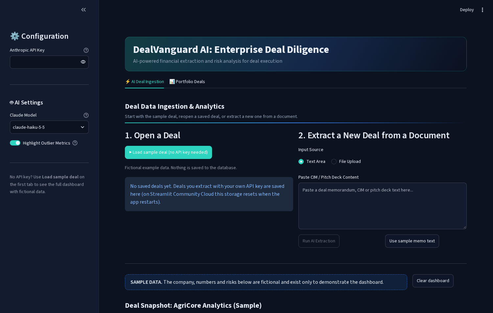
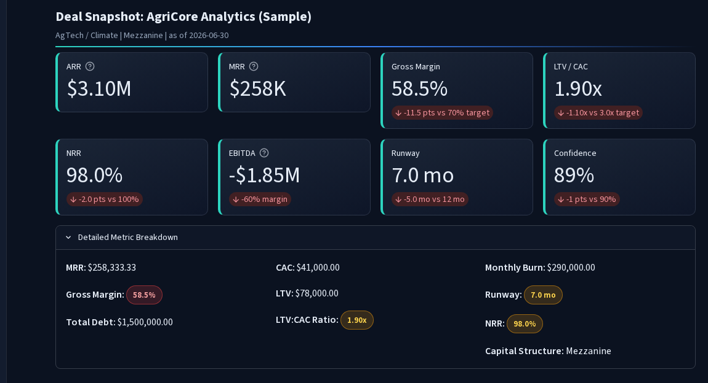
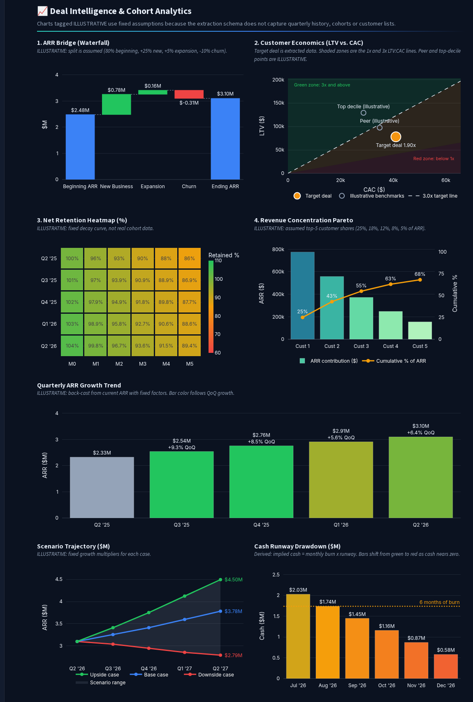
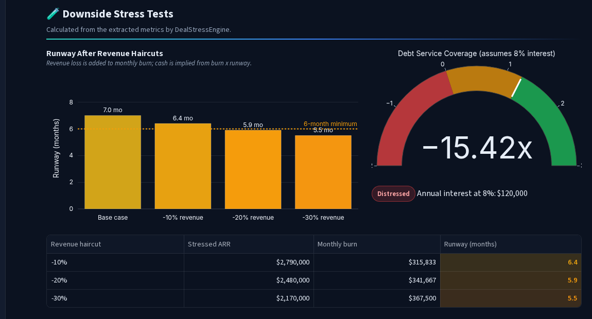
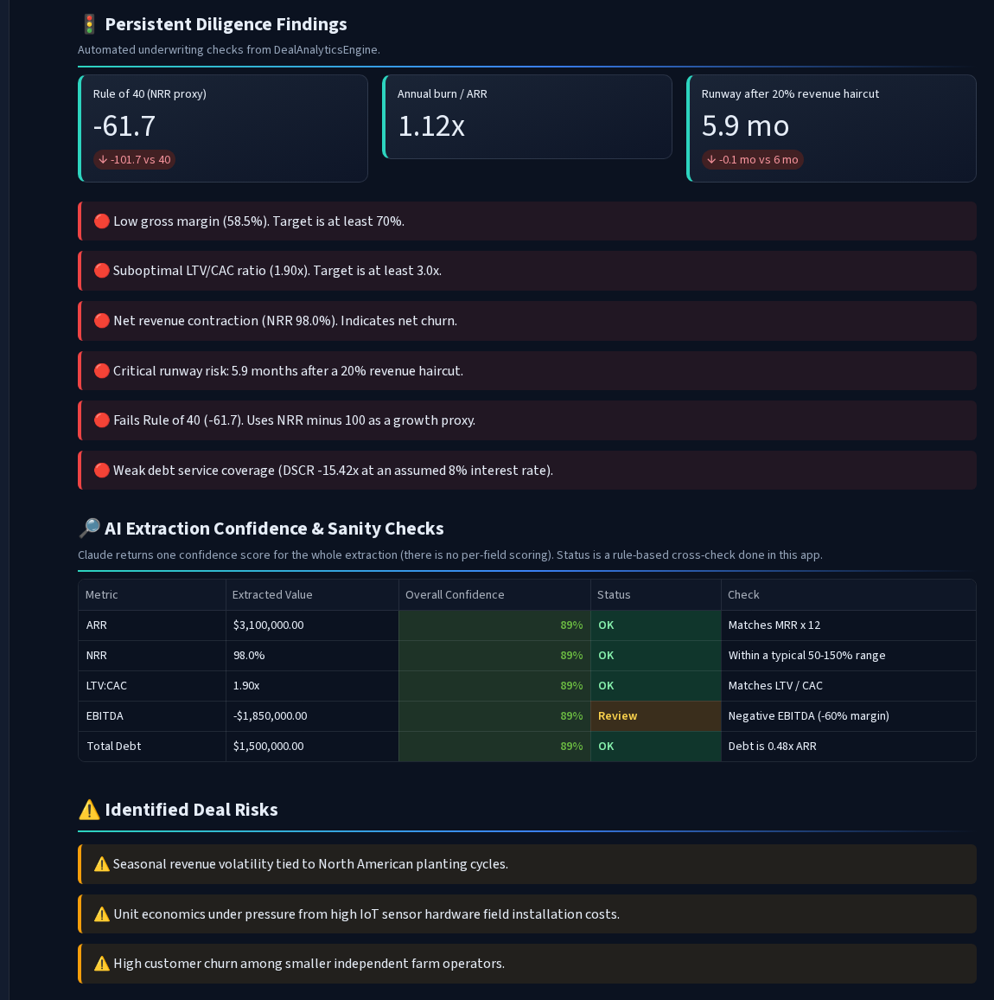
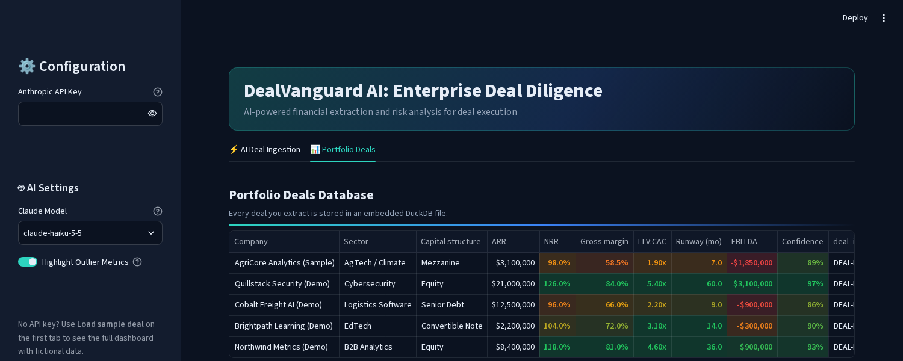
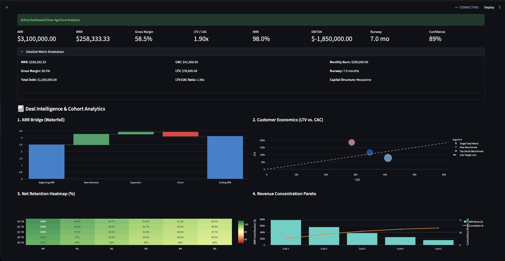
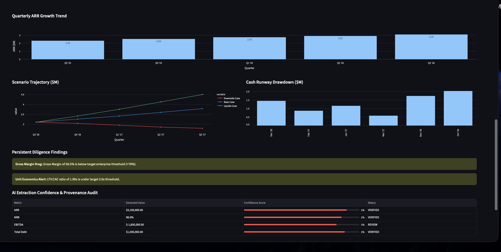
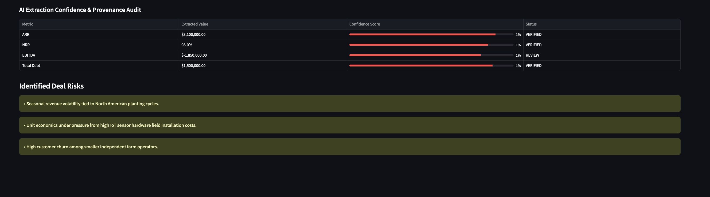
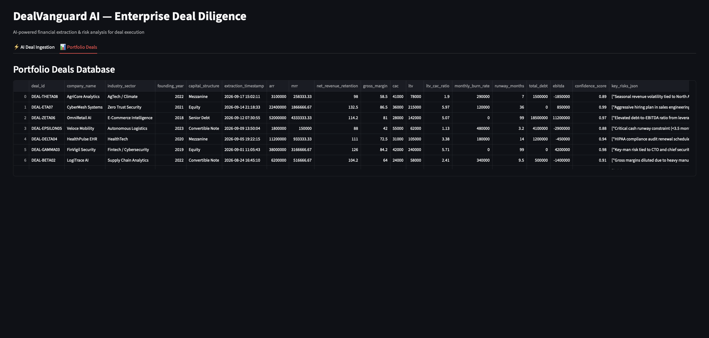

# DealVanguard AI: Deal Diligence & RevOps Analytics

[](https://dealvanguard.streamlit.app/)

**Live App:** [https://dealvanguard.streamlit.app/](https://dealvanguard.streamlit.app/)

The free Streamlit Community Cloud host sleeps when the app is idle. If you see a sleep screen, click **Yes, get this app back up!** and wait about a minute for it to reload. **No API key? Click "Load sample deal" on the first tab** to explore the full dashboard with fictional example data.

**Course:** Washington State University, MIS 448 capstone, revamped Sep. 2026.



## Overview and problem statement

This is a revamped MIS 448 capstone project. Before a private equity firm or lender commits to a software company, an analyst reads long deal documents (pitch decks, confidential information memorandums, data-room notes) and copies the key numbers into a model by hand: recurring revenue, retention, margins, customer acquisition cost, burn, and debt. That work is slow, and it is easy to mistype a number or miss a risk buried in the text.

**DealVanguard AI** is a Streamlit app that does the first pass. You paste or upload deal text, Claude reads it, and the app turns the answer into a strictly validated record, stores it, and shows the deal as a dashboard of SaaS metrics, charts, stress tests, and automated underwriting flags.

## Business context: deal diligence and RevOps

- **Deal diligence:** Is this company worth the price, and what could go wrong? Typical questions are how much cash is left, how fast it is burning, whether customers stay and expand, and whether the company can cover its debt.
- **RevOps (revenue operations):** The same metrics tell you whether the revenue engine is efficient. Net revenue retention (NRR) shows whether existing customers grow or shrink. Gross margin shows what is left after delivery costs. LTV:CAC compares what a customer is worth with what it costs to win one.

The app checks each deal against common rule-of-thumb targets: gross margin of at least 70%, LTV:CAC of at least 3x, NRR of at least 100%, at least 6 months of runway after a 20% revenue haircut, a Rule of 40 score of at least 40, and a debt service coverage ratio (DSCR) of at least 1.25x. These are screening thresholds, not investment advice.

## Features

- **Claude extraction with a data contract:** paste text or upload a `.txt` or `.md` file and Claude returns the metrics through a forced tool call whose JSON schema is generated from the Pydantic models.
- **Strict validation:** every result is checked (no extra fields, numeric bounds, an enum for capital structure). A bad answer fails loudly instead of reaching the dashboard.
- **Embedded DuckDB storage:** each extracted deal is saved and can be reopened later from the **Portfolio Deals** tab.
- **Dashboard:** KPI cards with deltas against target, a metric breakdown with status badges, and color-driven charts (ARR bridge, LTV vs. CAC zones, retention heatmap, concentration Pareto, ARR trend, scenarios, and a cash drawdown).
- **Stress tests:** runway after 10%, 20%, and 30% revenue haircuts, plus a DSCR gauge.
- **Automated underwriting flags:** Rule of 40, burn-to-ARR, stressed runway, and red flags in plain language.
- **Sanity checks:** simple cross-checks on the extracted numbers (for example, whether ARR matches MRR times 12).
- **Sample deal:** a fictional company loads with one click and needs no API key.

## Screenshots

The colors follow the numbers: red, amber, and green show how each value compares with its target.

**Deal snapshot (sample deal)**



**Deal intelligence and cohort analytics**



**Downside stress tests**



**Findings, sanity checks, and risks**



**Portfolio tab** (screenshot taken with several fictional demo deals saved; they are not part of the repo)



### Original capstone build

These four screenshots are from the first version, before the revamp. Two things changed afterwards: the confidence bar showed "1%" because a 0 to 1 value was formatted as a percent (fixed), and the dashboard did not yet have the stress-test section or color scales.






## How it works

```text
Deal text ──> Claude (forced tool call) ──> Pydantic models ──> DuckDB ──> Analytics + stress tests ──> Plotly in Streamlit
```

1. **Extraction (`ai_extractor.py`):** `DealExtractor` builds a tool definition from `ExtractionResult.model_json_schema()` and forces Claude to answer through it, so the reply has the shape the schema allows.
2. **Data contract (`schemas.py`):** `ExtractionResult`, `DealMetadata`, and `FinancialMetrics` are immutable Pydantic v2 models with bounds. Percentages (NRR, gross margin) are on a 0 to 100 scale. If validation fails, the app shows a "Data Contract Violation" error.
3. **Storage (`database.py`):** `DatabaseManager` writes each deal into an embedded DuckDB file (`data/dealvanguard.db`), and `record_to_extraction` rebuilds a saved row into the same Pydantic model.
4. **Analytics (`analytics.py`, `stress_engine.py`):** `DealAnalyticsEngine` computes the Rule of 40 and the underwriting flags. `DealStressEngine` applies revenue haircuts to burn and runway and computes DSCR.
5. **Charts and UI (`charts.py`, `theme.py`, `app.py`):** Plotly figures use one shared red-amber-green scale, and Streamlit lays out the tabs and sections.

## Sample deal walkthrough

Click **Load sample deal** on the **AI Deal Ingestion** tab. The app loads `sample_data/sample_deal.json`, a **fictional** company called AgriCore Analytics (an agriculture analytics company with IoT soil sensors). The data is validated by the same schema as a real extraction, and nothing is written to the database.

What the dashboard shows for it:

- **Snapshot:** $3.10M ARR, 58.5% gross margin, 1.90x LTV:CAC, 98.0% NRR, about -$1.85M EBITDA, and 7.0 months of runway. Each card shows its distance from the target in red or green.
- **Stress tests:** a 20% revenue haircut cuts runway from 7.0 to about 5.9 months. DSCR is about -15.4x, flagged as distressed (it uses an assumed 8% interest rate on $1.5M of debt).
- **Findings:** low gross margin, LTV:CAC below 3x, net revenue contraction, short stressed runway, a failed Rule of 40, and weak debt coverage.
- **Risks:** seasonal revenue, expensive sensor installation, and churn among small farms.

The sample is intentionally a weak deal, so the flags and color scales have something to show. To try the real extraction flow, click **Use sample memo text** (it fills the text box with a fictional memo from `sample_data/sample_deal_memo.txt`), enter your own Anthropic API key in the sidebar, and click **Run AI Extraction**.

## Project management

The capstone was planned as a four-phase schedule with a critical path. The Mermaid Gantt chart and critical path analysis are in [`docs/Schedule_Gantt_CPM_Analysis.md`](docs/Schedule_Gantt_CPM_Analysis.md), and GitHub renders the chart when you open the file.

- **Phase 1, Core Schemas & Storage:** metric schemas, tool-calling schemas, and the DuckDB engine.
- **Phase 2, AI Extractor Engine:** Anthropic API setup, Claude tool calling, and extractor tests.
- **Phase 3, Stress Engine & Math:** the revenue haircut engine and DSCR logic.
- **Phase 4, Streamlit UI & Release:** file upload, stress controls, and the portfolio data grid.

The baseline plan runs from Aug. 20 to Sep. 19, 2026, with milestones at the end of each phase, and tasks on the critical path are marked in red. It is the planning document, not a record of exactly what shipped. The code in this repo is the source of truth for the final features.

## Tech stack

- **Language:** Python 3.11+
- **AI:** Anthropic Claude API (tool calling)
- **Validation:** Pydantic v2
- **Database:** DuckDB (embedded)
- **Dashboard:** Streamlit, Plotly, pandas
- **Testing:** pytest, with the Claude client mocked (no API key needed)

## Project structure

```text
├── .streamlit/config.toml          # Dark theme
├── docs/
│   ├── images/                     # Screenshots used in this README
│   ├── DashboardViewEx1-4.png      # Screenshots of the original capstone build
│   └── Schedule_Gantt_CPM_Analysis.md
├── sample_data/
│   ├── sample_deal.json            # Fictional sample deal (loads with one click)
│   └── sample_deal_memo.txt        # Fictional memo you can paste into the extractor
├── src/dealvanguard/
│   ├── app.py                      # Streamlit app
│   ├── ai_extractor.py             # Claude tool-calling extractor
│   ├── schemas.py                  # Pydantic data contracts
│   ├── database.py                 # DuckDB persistence
│   ├── analytics.py                # Rule of 40 and underwriting flags
│   ├── stress_engine.py            # Revenue haircuts and DSCR
│   ├── charts.py                   # Plotly figure builders
│   ├── theme.py                    # Colors, CSS, chart styling
│   ├── formatting.py               # Number and date formatting
│   └── samples.py                  # Sample deal and memo loaders
├── tests/                          # pytest suite
├── .env.example
├── pytest.ini
├── requirements.txt
├── requirements-dev.txt
├── setup.py
└── README.md
```

## Run locally

1. Clone the repository:

```bash
git clone https://github.com/npfeifer-dev/DealVanguard.git
cd DealVanguard
```

2. Create a virtual environment and install dependencies:

```bash
python -m venv venv
source venv/bin/activate  # On Windows use: venv\Scripts\activate
pip install -r requirements.txt
```

3. Start the app:

```bash
streamlit run src/dealvanguard/app.py
```

The sample deal works with no API key. To run extraction, paste your Anthropic API key into the sidebar, or copy `.env.example` to `.env` and set `ANTHROPIC_API_KEY`. Do not commit `.env` (it is already in `.gitignore`).

## Run the tests

```bash
pip install -r requirements-dev.txt
pytest
```

The suite covers the schemas, the extractor (with a mocked Claude client), the database round trip, the analytics and stress engine, and the sample data. It does not need an API key or network access. The tests are run by hand; this repo has no automated CI workflow.

## Scope notes

- **Bring your own key:** extraction uses your own Anthropic API key. The app does not ship a key, and it is held only for your current session and never saved to the database.
- **Fictional sample:** the sample deal and memo are made up for demonstration. They are not real company data.
- **Illustrative charts:** the ARR bridge, peer benchmarks, retention heatmap, concentration Pareto, ARR trend, and scenario lines use fixed assumptions because the extraction schema does not capture quarterly history, cohorts, or customer lists. Each one is labeled ILLUSTRATIVE in the app. The KPIs, LTV vs. CAC point, cash drawdown, stress tests, and flags are calculated from the extracted metrics.
- **Assumptions in the math:** cash is implied from monthly burn times runway (the schema has no cash balance), DSCR assumes 8% interest on total debt, and the Rule of 40 uses NRR minus 100 as a growth proxy.
- **Confidence score:** Claude returns one confidence score for the whole extraction. There is no per-field scoring, and the sanity-check statuses are simple rules in this app.
- **Storage:** on Streamlit Community Cloud, saved deals live in a local file that resets when the app restarts.
- **Models:** the sidebar lists Claude models that accept the forced tool call this extractor uses. Anthropic retires models over time, so update `SUPPORTED_MODELS` in `ai_extractor.py` if one stops working.
- **Capstone scope:** this is a student project built to demonstrate the pipeline. It is not investment software.
